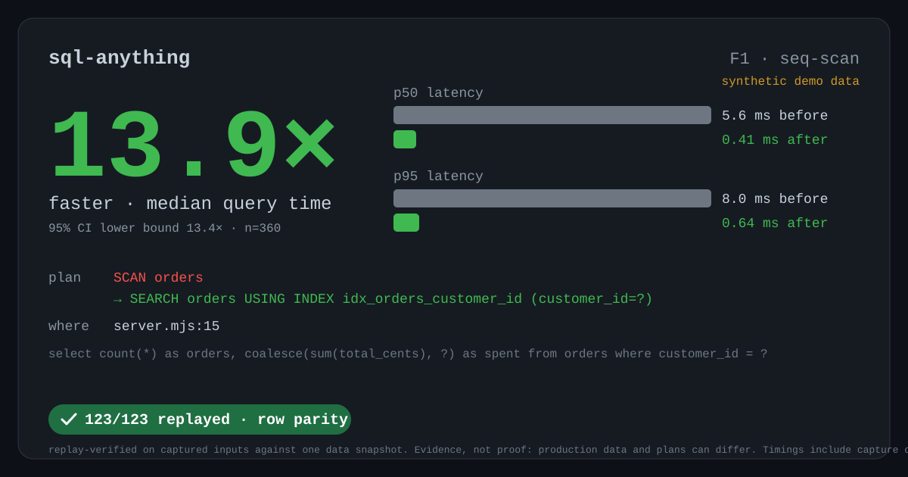
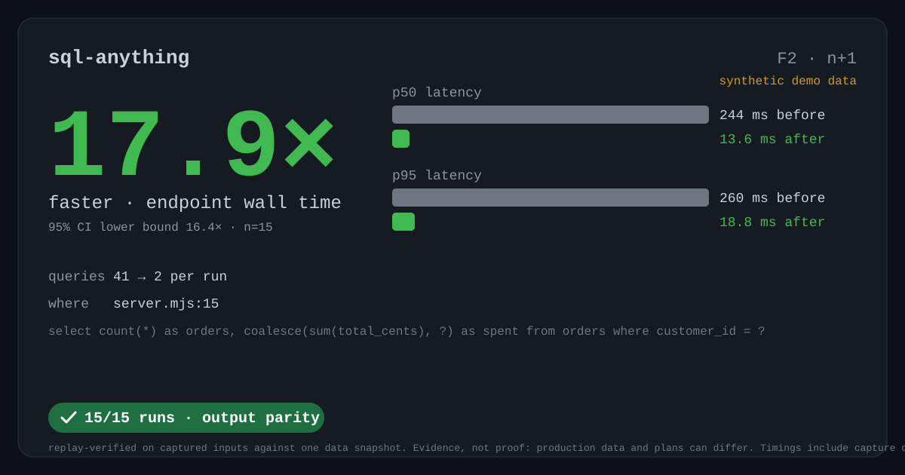

# sql-anything

**Don't rewrite your backend in Rust. Fix the 5% of SQL queries killing it.**

Most slow backends are slow because of SQL, not because of Node or Python: N+1 loops, missing indexes, scans that throw away
99% of the rows. `sql-anything` finds those queries in your running app with the exact `file:line`, lets an agent (or a
deterministic index generator) fix them, and **refuses any fix it cannot replay-verify**.




> These two cards come from a real `sql-anything go --agent claude` run on the **synthetic** `examples/sqlite-shop` app
> (the slowness is staged). They show the loop working end to end, not a benchmark of your code. For what happened on a real
> open-source app, including what the gate refused, read [docs/benchmarks/conduit/RESULTS.md](docs/benchmarks/conduit/RESULTS.md).

## 15 seconds

```bash
npx sql-anything demo
```

No Docker, no API key, no network. It seeds a synthetic SQLite shop, captures real requests, finds an N+1 and unindexed
filters, fixes them (deterministic index candidates plus a recorded code fix, no LLM), runs every fix through the same gate as
a real run, and writes a report and SVG cards to `./sql-anything-demo/`.

## On your app

```bash
npx sql-anything go --db <sqlite-file | postgres://...> --agent claude \
  --hit http://127.0.0.1:3000/slow-page \
  --check-url "http://127.0.0.1:{port}/slow-page" --run "node server.js" \
  -- node server.js
```

`go` runs your app with a capture hook (`NODE_OPTIONS=--import`, no code changes), requests the URLs you give it, ranks the
findings, fixes the top ones, verifies each fix, and writes the report. It prints its plan first (`--dry-run` stops there).
Your repository and database are **not modified**: verified changes are written as files under `.sql-anything/`.

Works with `pg`, `better-sqlite3` and `node:sqlite`, so Drizzle, Knex, Kysely, Sequelize and **Prisma 7** (driver adapter over
`pg`) are covered. Not covered yet: Prisma 6 and earlier (native query engine), bundled/serverless apps that drop
`NODE_OPTIONS`, other languages. Node 22.13 or newer.

| command | what it does |
|---|---|
| `scan` | capture + rank: N+1 loops with `file:line`, selective sequential scans, correlated subqueries, slow statements. `EXPLAIN` runs on a **clone**, never the live database |
| `fix F1` | deterministic `CREATE INDEX` candidates first (no LLM), then an agent in a git worktree for code changes. `--migration idx.sql` puts your own index through the same gate |
| `verify` / `bench` | replay-verify a migration or SQL rewrite, or (`--baseline-dir/--patched-dir`) an application-code change end to end |
| `report` | Markdown PR block + dark-mode SVG card, from verified numbers only |
| `go` | all of the above in one command |
| `mcp` | the same tools for an agent over MCP |
| `demo` | the 15-second synthetic showcase |

## What "verified" means

Every fix runs on **clones** of your database (the source is only read):

- **`N/N replayed · row parity`.** Up to 500 captured, parameterized queries are replayed before and after. Results must be
  identical: same columns, same rows, same duplicates, NULLs distinct from empty strings, and the **same order** when the
  query has an `ORDER BY`. Same rows in a different order is rejected (ties broken differently means a behaviour change).
  NOT IN → NOT EXISTS with a NULL in the list, LEFT → INNER JOIN, a join that multiplies rows: all caught by the trap suite.
- **Randomized, interleaved A/B timing** with a bootstrap confidence interval. The gate uses the **lower bound** of the
  speedup (default 1.5x), not a lucky median.
- **A/A noise floor.** A third, untouched clone measures how different two identical copies look, so the regression guard only
  fires on slowdowns bigger than that noise.
- **Regression guard.** Nothing outside the target query may get more than 10% slower.
- **Write-regression guard.** Captured `INSERT`/`UPDATE`/`DELETE` are replayed in rolled-back transactions; a patch whose
  indexes make writes more than 15% slower, or make a captured write fail (a surprise UNIQUE index), is rejected.
- **Volatile queries are excluded, not guessed.** `now()`, `random()`, sequences, `LIMIT` without `ORDER BY`, unserializable
  params and schema introspection are marked **unverifiable** (exit code 4). Nothing unverifiable is ever reported as a win.
- **N+1 fixes are verified end to end** (`--check-url` / `--check-cmd`): the app runs before and after on identical clones,
  canonicalized JSON/stdout must match (noisy fields such as timestamps are auto-masked after comparing two baseline runs), and
  wall time must improve with a CI lower bound. The report shows queries per request, e.g. `41 -> 2`.
- **Reversible.** A code fix is saved as `fix.patch` (`git apply -R` rolls it back); an index comes with `down.sql`. Nothing
  is applied to your repo or database for you. `SQL_ANYTHING_DISABLE=1` makes the hook do nothing and `go`/`fix` refuse to run.

This is **evidence, not proof**: captured inputs, one data snapshot, a cloned database. Production data and plans can differ.
Every card says so. Timings include the capture hook's overhead (about 3 µs per query).

The gate is strict on purpose. On a real app (conduit, Sequelize + Postgres) it refused every patch it was given: generated
indexes that did nothing (0.98x to 1.10x), hand-written indexes that reordered a JSON array the SQL never pinned, and the real
`claude` CLI's code change for the same reason. That is the gate working, and it is why this README's headline numbers come from
the synthetic examples and not from a real app: there is no verified real-app speedup yet.
[The full log, including what failed](docs/benchmarks/conduit/RESULTS.md).

## Examples (synthetic, clearly labeled)

- [`examples/sqlite-shop`](examples/sqlite-shop): zero Docker, zero dependencies, 100k orders, an N+1 endpoint and an unindexed filter.
- [`examples/postgres-saas`](examples/postgres-saas): Postgres via `docker-compose.yml`, 640k rows, an N+1 driver loop, an
  unindexed multi-table join and a correlated subquery. One command: `npm run setup`.

## Claude Code, MCP and the skill

```bash
claude mcp add sql-anything -- npx -y sql-anything mcp
```

Tools: `scan`, `verify`, `verify_workload`, `fix` (deterministic index path), `report`. Findings contain normalized SQL only, never
parameter values. The agent skill is [`skills/sql-anything/SKILL.md`](skills/sql-anything/SKILL.md): when to use the tool, the
verify-before-claiming rule, the 3-attempt budget, and the safety rules. Copy it to `~/.claude/skills/sql-anything/` to load it.

## Safety

- The source database is read only. Shadow clones are local-only (a non-local Postgres host is refused unless you pass
  `--allow-remote-shadow`, because the clone would copy that data) and are dropped afterwards.
- `EXPLAIN ANALYZE` runs on a clone. Agents run in a git worktree with every database connection variable removed from
  their environment, and see the normalized statement, never parameter values.
- Traces in `.sql-anything/` contain real query parameters. The directory git-ignores itself.
- Exit codes: `0` verified win / nothing to fix, `2` patch rejected, `3` usage or environment error, `4` nothing captured or unverifiable.

## Status

v0.1, pre-release. Tested on Windows with Node 24 against SQLite and a real Postgres (an embedded build). Be aware of what
has and has not been exercised:

- The real `claude` CLI agent loop was run by hand on the synthetic SQLite shop (verified) and on conduit (rejected by the gate).
  CI uses a scripted stand-in agent.
- `examples/postgres-saas/docker-compose.yml` has **not been run**; the example's schema, seed and server are tested against an
  embedded Postgres instead.
- Not yet run: macOS, Linux, Postgres below 15, remote databases, apps that bundle their dependencies.

MIT licensed.
